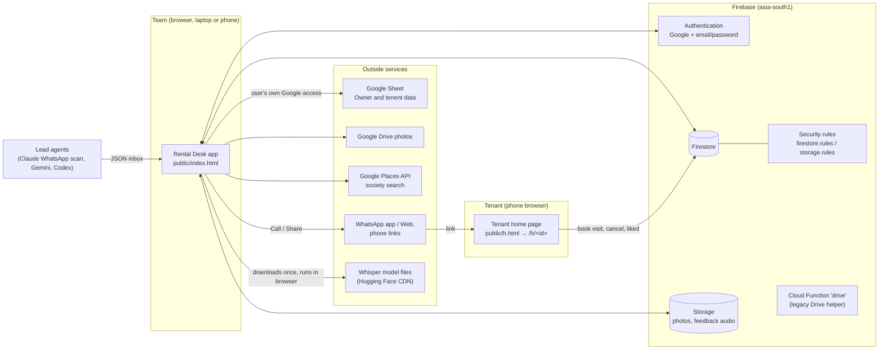
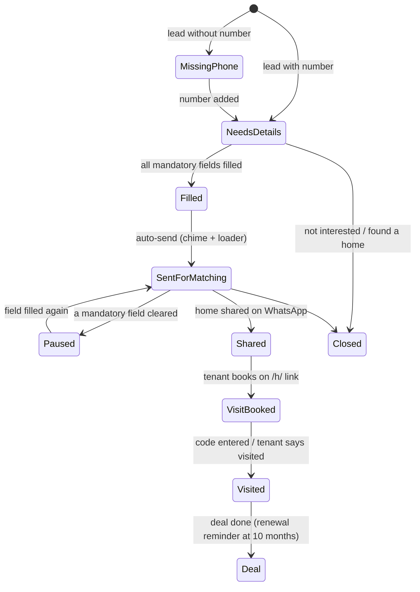

# Rental Desk – system architecture

Live: https://rentaldesk.trustkeyper.com (Firebase project `trustkeyper-rental-desk`, owner info@trustkeyper.com).
Repo: `desicode-blip/Trustkeyper---Rental-Desk` (branches `staging` and `main`).
Separate from the TK2 mobile app; TK2 code is never changed (its tenant-page design and wording are copied).

## 1. Big picture



## 2. Data (Firestore collections)

| Collection | What it holds | Who can read / write |
|---|---|---|
| `leads/{id}` | Every tenant, property and broker lead: details, call history, follow-ups, matching state (`confirmedAt`), homes shortlist (`shortlist`, `matchLog`, `deal`), `areaKeys`, `viewers` | Admins: all. Members: only leads whose `viewers` list has their email |
| `access/{email}` | Team access: `limited`, `sheet`, `propAreas`, `tenAreas`, `noAreaProps`, `noAreaTenants`, `fee` | Admins write; each person reads their own |
| `profiles/{email}` | Name, phone, language (en/hi/te), joined date | Owner reads/writes own; admins read all |
| `config/*` | Desk settings (Places key, sheet sync state, society areas) | Members read |
| `feedback/*` | Help & feedback notes and voice | Author, shared ones, admins |
| `shares/{id}` | Public snapshot of a home sent to a tenant (no flat no., owner or keys) | Anyone with the exact link can open one; members create |
| `visits/{id}` | Visit booked from a tenant link: day/time, name, phone, 4-digit code, status, liked | Tenant creates and updates own by id; members with access read |
| `replies/{id}` | "Not for me" taps from a tenant link | Tenant creates; members with access read |

## 3. Access control

```mermaid
flowchart TD
  A[Person signs in] --> B{Email confirmed?}
  B -- no --> V[Check your email screen]
  B -- yes --> C{Admin email<br/>or access/{email} exists?}
  C -- no --> N["Access not given yet<br/>call +91 80885 16875"]
  C -- yes --> D{Profile has name + language?}
  D -- no --> O[Onboarding: name, phone, language]
  D -- yes --> E[Desk opens]
  E --> F{Admin?}
  F -- yes --> G[Loads all leads]
  F -- no --> H["Loads leads where viewers contains my email"]
```

- Admins: `info@trustkeyper.com`, `amanmaheshwari900@gmail.com` (always see everything).
- `viewers` on each lead is computed from Team access (sheet leads on/off, property areas, tenant areas, no-area leads). The admin's open desk recomputes it (`reconcileViewers`). Server-side recompute needs the "Cloud Datastore User" role on the compute service account.
- `areaKeys` = localities from the lead's societies/areas (via the area map), written on every save.

## 4. Lead life cycle



## 5. Matching rules (`match(t,p)`)
- Whole home vs room must agree. BHK must match; 2.5 BHK also matches 2 and 3 BHK (flagged to confirm).
- Furnishing, area/society, tenant type, food, pets must not conflict.
- Rent (plus maintenance if the tenant's budget is all-inclusive) ≤ budget; with "Budget is adjustable" up to budget + stretch (flagged to confirm).
- Home must be available by the move-in date.
- Ranked: in-budget, exact BHK, area, furnishing first.

## 6. Call listener
Call button → pick app (WhatsApp app, WhatsApp Web, linked phone, other, copy) → listener panel. Microphone (+ optional shared tab/screen audio) → 16 kHz mono → 6-second chunks → Whisper-base in a Web Worker (transformers.js, WebGPU or WASM) → English text → pattern pick-up of budget, rooms, furnishing, tenant type, move-in, pets, food, areas → "Fill" buttons. Nothing leaves the browser except the model download.

## 7. Files

| Path | Purpose |
|---|---|
| `public/index.html` | The whole desk (UI, logic, translations, call listener) |
| `public/h.html` | Tenant home page (TK2 look and journey) |
| `public/rtest.html` | Screen-size test page (desk at several widths) |
| `firestore.rules`, `storage.rules` | Security rules |
| `firebase.json` | Hosting (no-cache, same-origin framing, `/h/**` route), rules, functions |
| `functions/` | Legacy Drive helper function |
| `docs/` | This document and the tutorial |

## 8. Deploy
`firebase deploy --only hosting` (add `firestore:rules,storage` when rules change), signed in as info@trustkeyper.com. Every change is committed to `staging`, then fast-forwarded to `main`.
